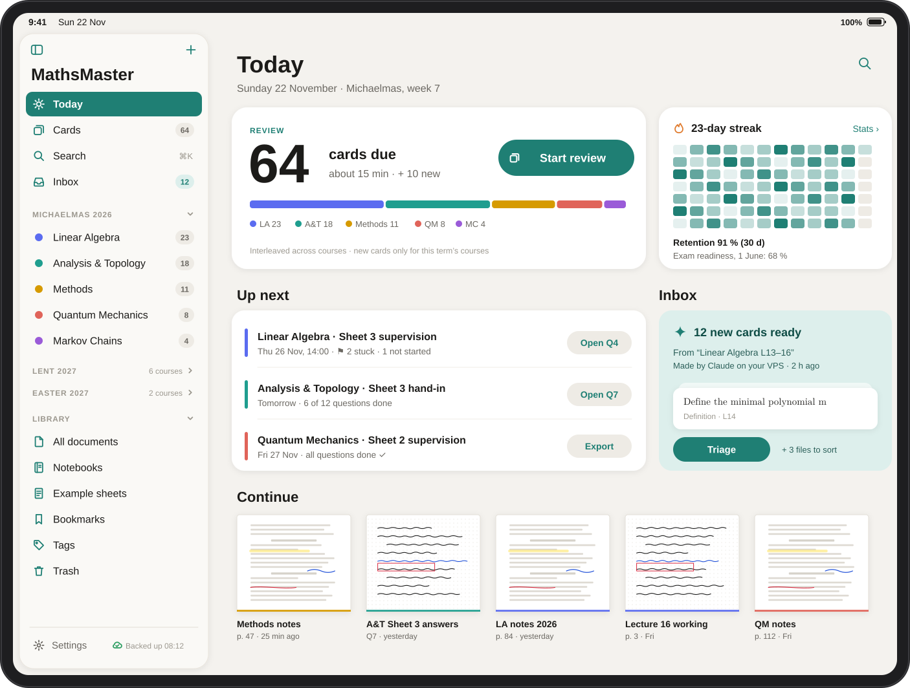
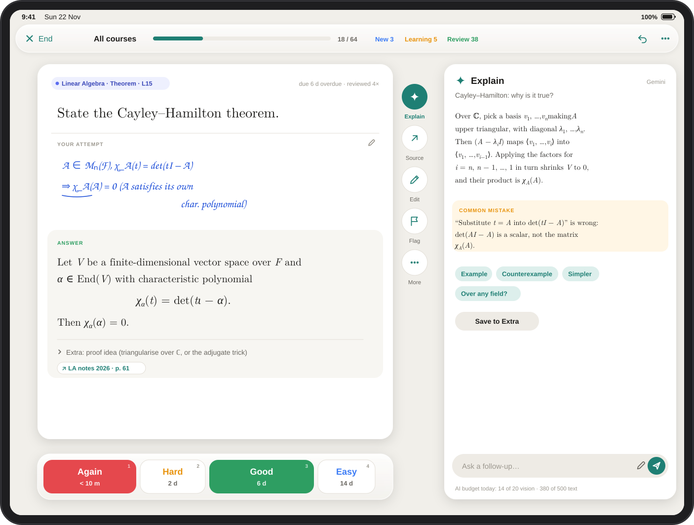
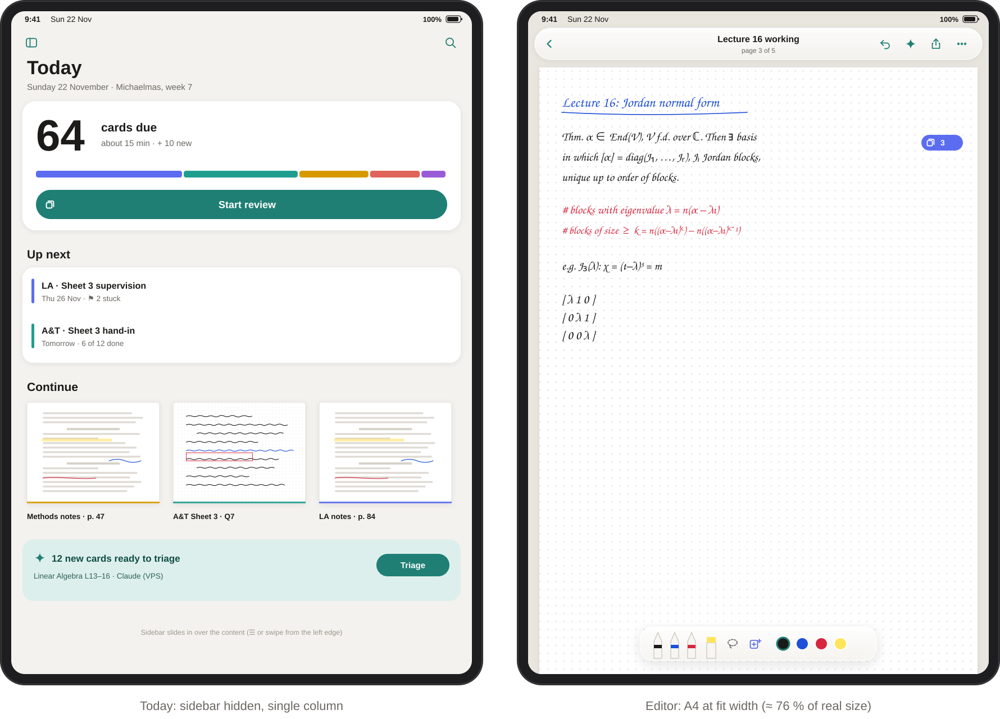
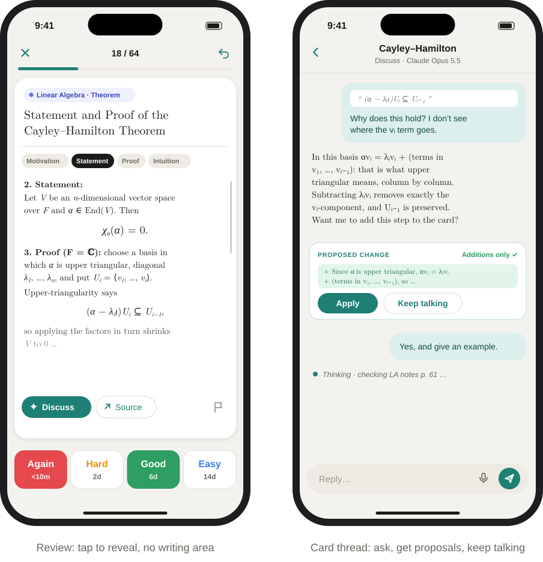

# MathsMaster: design plan (v2)

> **Status:** v2, revised after the owner's review (decisions in §10) · **Date:** 22 Nov 2026 (Michaelmas, week 7)\
> **Scope:** layout, UX, data and platform decisions. There's no app code yet. Every later task builds on this document; if a task needs to depart from it, change this file in the same PR.\
> **Mockups:** [`docs/mockups/`](mockups/). The rendered version with the mockups inline is `docs/mockups/design-plan.html`.

MathsMaster is a native SwiftUI iPad app: the single place for a Cambridge Part IB maths degree. It holds courses, lecture notes you write on with the Pencil, example sheets and your answers, handwritten notebooks that print cleanly, and flashcards on a modern spaced-repetition scheduler (FSRS), with AI helping to make and explain the cards.

---

## 0. The decisions, in one table

| # | Area | Decision | Why |
|---|------|----------|-----|
| 1 | Shell | **Two-column `NavigationSplitView`** (sidebar → course page). Documents and reviews open **full screen** on top. | Keeps the library calm and the canvas as large as possible. A third column is too cramped on an 11″ in portrait. |
| 2 | Unit of organisation | **Course** is the hub. Each course has four shelves: *Lecture notes · Example sheets · Notebooks · Cards*. Courses sit under Year → Term. | It matches how the degree is actually structured, so there's nothing new to learn. |
| 3 | Home | **Today** opens first: cards due, the next supervision, *Continue where you left off*, and the AI inbox. | Answers "what should I do now?" in one glance. |
| 4 | Editor | **One page engine for everything.** A document is a stack of pages. Each page has a *background* (a PDF page or a template) and an *ink layer* (PencilKit). | Lecture notes, example sheets and notebooks behave the same way, and you can insert blank pages into a PDF or PDF pages into a notebook. |
| 5 | Ink | **PencilKit `PKCanvasView` + the system `PKToolPicker`**, Pencil-only drawing by default, and the canvas kept in light style on white paper. | This is the same ink Apple Notes uses, and it brings squeeze, double-tap, hover and new tools (e.g. the reed pen in iPadOS 26) for free. |
| 6 | Originals | **PDFs are never modified.** Ink lives in a sidecar next to the PDF. Exports produce a new, flattened PDF. | Lecturers' PDFs stay pristine and replaceable, and sync stays cheap. |
| 7 | Cards | **Anki-compatible HTML + MathJax** (your existing format), rendered with bundled MathJax. Big, self-contained "macroscopic" cards as your guidelines describe. **One deck per course + one global queue**, and no nested decks. Your Anki decks are imported with their review history. | Your decks come in unchanged, your card guidelines apply almost as written, and nothing is locked in. |
| 8 | Review | **Write first, then reveal.** Below the front is a big writing space that grows as you write, so whole proofs fit. Revealing opens the answer **beside your attempt** to compare. FSRS-6, four grade buttons showing the next intervals. | Active recall by writing out proofs is how maths is examined. |
| 9 | AI | **Claude Opus 5.5 on your VPS for everything** (owner decision: no Gemini). Whole-course context plus your card guidelines, every time. You **talk to it**: per-card threads with proposals you can apply or argue with. Everything generated lands in an **Inbox** first. | Hard maths needs a frontier model working agentically. No AI credentials in the app; nothing in GitHub Actions (public repo). |
| 10 | Storage | **Files are the truth**: a human-readable folder in iCloud Drive that you pick once (security-scoped bookmark). Databases, thumbnails and the search index are disposable caches. | Works without entitlements, survives app reinstalls, is shared by the Playgrounds and SideStore copies, and is inspectable in the Files app and on the PC. |
| 11 | Conflicts | **Append-only review logs per app install; per-page ink files; per-card timestamps.** | Two app copies (or two devices) can never corrupt each other's work. |
| 12 | VPS | **Backup mirror + the Claude runtime + the Anki importer.** It isn't the live sync; iCloud does that. | Offline-first app; the mirror also gives Claude your latest notes without per-request uploads. |
| 13 | Look | **Quiet paper-and-ink UI.** SF Pro for the interface, the LaTeX look (MathJax + Latin Modern) for card content, one teal accent plus a colour per course, Liquid Glass only for floating controls. | Content first. It should look at home on iPadOS 26. |
| 14 | Platform | **iPadOS 26 deployment target, Swift 6, built with the iOS 26 SDK**, the SDK that ships in Swift Playground 4.7. CI uses Xcode 26.x to match. | The newest APIs that the iPad can actually compile. |
| 15 | MVP | **Phase 1 = courses + writing on PDFs + notebooks + print**, runnable from Playgrounds. Flashcards and your Anki decks follow straight after (Phase 2), then Claude (Phase 3) and the iPhone companion (Phase 4). | Ink is both the core input and the riskiest part, so it gets proven first. |
| 16 | iPhone | **A companion app** from the same code (SideStore install). It reviews cards without writing, reads everything, and does threads and Inbox triage. | The degree hub belongs in your pocket too; proofs get written on paper there. |

---

## 1. Who it's for, and the principles

**The user:** a second-year Cambridge maths student. Michaelmas has about 5 courses (e.g. Linear Algebra, Analysis & Topology, Methods, Quantum Mechanics, Markov Chains), Lent has about 6 more, then Tripos in late May/June. Each 24-lecture course has a set of lecture notes (usually one long LaTeX PDF), about 4 example sheets with supervisions, and lots of handwritten working. They already have **Anki decks for several courses**, made by AI agents following a detailed set of **card guidelines** (§5.4). The main device is an iPad Air (M4, 2026) with an Apple Pencil: 11″ or 13″, 60 Hz display, Pencil hover supported. An iPhone is used for review on the go (§6.10).

**Principles.** Every later decision should be checked against these:

1. **Ink first.** The Pencil is the primary input everywhere it makes sense: notes, answers, the writing space on every card, and even maths for typed card text (Claude transcribes it). Nothing may make ink feel worse than Apple Notes.
2. **One home per course.** Anything you own for a course is one tap from its page. There's no hunting through folders.
3. **Files are the truth.** Your work is ordinary files in a folder you can see. The app can be deleted, rebuilt or replaced, and nothing is lost.
4. **AI proposes, you decide.** AI never silently changes your notes or cards. Its output is a suggestion with *Accept / Edit / Reject*.
5. **Fast in crunch week.** Opening a document, starting a review or finding a theorem must take one or two taps and feel instant. Supervision is tomorrow.
6. **Offline by default.** Everything except AI works on a train with no signal.
7. **Looks like a maths book.** Typeset content uses the fonts of a LaTeX document, with calm colours and nothing gamified for its own sake.

**Non-goals for v1:** collaboration or sharing, a web app, typed rich-text notes (handwriting is the notes medium; typed text lives on cards), PDF forms and signatures, and live two-way Anki sync. (A one-off Anki import with review history *is* in scope: §4.8.)

---

## 2. Information architecture and navigation

### 2.1 The objects

```
Library (one folder in iCloud Drive)
└── Year  (e.g. "Part IB 2026–27"; older years go under Archive)
    └── Term  (Michaelmas · Lent · Easter)
        └── Course  (name, colour, term, lecturer, exam date)
            ├── Lecture notes   – PDFs, with your ink in a sidecar
            ├── Example sheets  – question PDF + answers notebook + per-question status + supervision date
            ├── Notebooks       – template pages of handwriting
            └── Cards           – the course deck
Cross-cutting: Tags (#compactness), Bookmarks (e.g. "Lecture 16" on a page),
               Links (card ↔ page region), Recents, Inbox (AI output), Trash
```

- **Document kinds** are just three: *Annotated PDF*, *Notebook*, *Example sheet*. An example sheet is a question PDF paired with an answers notebook. All three open in the same editor (§3).
- **Bookmarks** are named page anchors. The main use is *"Lecture 16 starts here"*. They give the course an outline (Lecture 1…24) that drives *"cards from lectures 13–16"*, the course progress line, and jump-to.
- **Tags** apply to documents, pages and cards. They're optional, flat and lower-case. The AI suggests them, and you can ignore them happily.

### 2.2 The shell


**Decision:** a `NavigationSplitView` with **two columns**, *sidebar* and *detail*. Opening a document, a review session or the card browser **pushes a full-screen view** with a zoom transition from the thumbnail (iOS 18+ `navigationTransition(.zoom)`), and the sidebar slides away. *Back*, a swipe from the left edge, or ⌘[ returns you to exactly where you were.

The sidebar, top to bottom:

| Section | Items |
|---|---|
| (pinned) | **Today** · **Cards** (all decks, browser, stats; badge = cards due) · **Search** (⌘K) · **Inbox** (badge = AI cards to triage) |
| *Michaelmas 2026* (current term, expanded) | One row per course: a colour dot, the name, and a due-count badge. Rows reorder by drag. |
| *Lent 2027*, *Easter 2027* | Collapsed until their term starts; you can expand them any time. |
| *Library* | All documents · Notebooks · Example sheets · Bookmarks · Tags · Trash |
| (footer) | Settings ⚙︎ · sync status (iCloud ✓ / VPS backup time) |

Why not three columns (sidebar → list → detail, as in Mail and Notes)? A course isn't a list of similar items. It's a *dashboard* of four different kinds of thing, and a dashboard needs width. On an 11″ in portrait a third column leaves about 450 pt for the content. Two columns plus full-screen documents gives every screen the room it needs.

**Adaptive behaviour** (one layout, driven by width rather than device):

| Window width | Sidebar | Course page | Editor |
|---|---|---|---|
| ≥ 1180 pt (13″ landscape, 11″ landscape) | Tiled, 300 pt | 3-column shelf grid | Optional reference pane (35–45 %) beside the page |
| 800–1180 pt (portrait, large Stage Manager window) | Overlay; swipe or ☰ to reveal | 2-column grid | Reference pane as a slide-over sheet |
| < 800 pt (small window, iPadOS 26 tiling) | Collapses to a navigation stack (automatic in `NavigationSplitView`) | 1-column list | Page strip hidden, toolbar condensed |

### 2.3 Today (home)



Today is the launch screen. It answers *"what now?"* and offers nothing to configure. The blocks, in priority order:

1. **Header:** *Sunday 22 November · Michaelmas, week 7* (Cambridge week numbering, from term dates in Settings).
2. **Review hero:** *64 due · about 15 min* plus a big **Start review** button (the global queue, §4.2). Under it is a thin stacked bar per course and *+10 new today*. When nothing is due: *All done*, the next due time, and a *Learn 10 new* button.
3. **Up next:** deadlines from example sheets and courses, e.g. *Linear Algebra, Sheet 3 supervision Thu 26 Nov: 2 questions marked Stuck, 1 not started* → tap opens the sheet at the first unfinished question.
4. **Continue:** the 4–6 most recent *locations* (document + page) as large thumbnails, e.g. *Methods notes, p. 47*.
5. **Inbox:** *12 AI cards from "Linear Algebra L13–16" are ready* → triage (§4.5).
6. **Streak and heatmap:** a small 12-week heatmap, the streak, and true retention over the last 30 days. Tap opens Stats.

### 2.4 Course page

The course page is the detail view for a course (mockup 01). From top to bottom:

- **Header:** a colour band, the course name, *Michaelmas 2026 · 24 lectures*, and one progress line (*Lecture 16 of 24 · Sheet 3 supervision Thu · 23 cards due*). There's a **Review this course** button and a **＋** menu: Import PDF… · New notebook · New example sheet… · New card · Scan paper…
- **Shelves:** *Lecture notes*, *Example sheets* (each with status chips: ✓ done, ● in progress, ⚑ 2 stuck, and the supervision date), *Notebooks*, and *Cards* (deck summary: total, due, retention, and *Browse* / *Add*).
- **Outline:** a collapsible list of bookmarks (*Lecture 1 … Lecture 16*). Tapping one jumps into the notes at that page.
- **Drag and drop:** drop PDFs from Files or Safari anywhere on the page to import them. The kind is guessed from the file name (*"sheet"*, *"example"* → Example sheet).

### 2.5 Library organisation, recents and tags

- **On disk, folders are courses** (§7.2). In the UI you never manage folders, only courses and documents.
- **Sorting:** shelves sort by *last opened* by default (alternatively by name, or by lecture order for notes). *All documents* has a grid/list toggle and filter chips (course, kind, tag).
- **Recents** are *locations*, not files: the 20 most recent (document, page, zoom) entries. They feed Today → Continue, the empty state of ⌘K, and the editor's back/forward history, so following a card's source link and pressing *Back* returns you to the review.
- **Smart lists** (built in, not user-defined in v1): *Stuck questions*, *Flagged cards*, *Leeches* (cards failed ≥ 8 times), and *Untriaged inbox*.
- **Tags** are added from the info sheet of a document, page or card, or accepted from AI suggestions. Tapping a tag shows everything with it, across courses.

### 2.6 Search

**Decision:** one **global search panel** (⌘K, the sidebar *Search* row, or pulling down on Today). It looks like Spotlight: a field, **scope chips** (*All · Cards · Lecture notes · Sheets · Notebooks · Handwriting*) and a **course filter**. Results are grouped by kind. Each result shows a page thumbnail with the hit highlighted and a text snippet. Return opens the result at the exact page.

What gets indexed (all on device, in a rebuildable cache):

| Source | How | Quality |
|---|---|---|
| Titles, tags, bookmarks | direct | perfect |
| Card text | direct (HTML stripped to text; MathJax source kept) | perfect |
| PDF text | PDFKit `page.string` | good for prose; maths in LaTeX-generated PDFs extracts as garbage, so we don't rely on it for formulas |
| Handwriting | Vision text recognition on rendered ink, per page, re-run when the page's ink changes; keeps bounding boxes for highlighting | good for words ("compact", "Sylow"), poor for symbols |
| AI transcripts | when Claude transcribes a page or region (§5), the transcript is indexed | good for maths; only covers pages AI has seen |

Extra: **Study these.** Any card-search result set can start a review session (custom study), e.g. search `#eigenvalues` → *Review 14 cards*.

### 2.7 Getting things in

- **Import:** `.fileImporter` (multiple PDFs), drag and drop from Files/Safari/Mail in a split-screen window, **Scan paper…** (VisionKit document camera, for supervisor feedback or paper notes), and **Paste** (a PDF or image on the clipboard).
- **Drop folder:** anything you put in `MathsMaster/Inbox/Import/` from the Files app or the PC turns up as *"3 files to sort"* on Today. This replaces the share extension we can't build (§8).

---

## 3. The editor: notes, PDFs and example sheets


### 3.1 One page engine

**Decision:** every document is an ordered **list of pages**. Each page has:

```
Page
  id            UUID (stable; ink files and card links point here)
  size          A4 portrait by default (595 × 842 pt); a PDF page keeps its own size
  background    .pdf(sourceFile, pageIndex)  |  .template(kind, spacing, paper colour)
  ink           one PencilKit drawing (its own file), in page coordinates
  bookmarks     e.g. "Lecture 16"
  links         card IDs anchored to rects on this page
  question      (example sheets) which question this page answers
```

What this gives us for free:

- An **annotated PDF** is a page list over the original PDF. You can **insert blank or grid pages** between PDF pages (*"I need room to work through this proof"*) without touching the PDF.
- A **notebook** is a page list of template pages. You can **insert a PDF page** (e.g. a question) into it.
- An **example sheet** is a question PDF plus an answers notebook, shown side by side (§3.7).
- Exporting, printing, thumbnails, search and card links work identically for all three.

**Rendering approach (decided by a Phase-0 spike):**

- **Plan A:** `PDFView` with a `PDFDocument` built from the page list. PDF pages are copied in, and template pages are drawn by a `PDFPage` subclass. A `PDFPageOverlayViewProvider` attaches one `PKCanvasView` per visible page, with `isInMarkupMode = true` (iOS 16+). This gives zoom, continuous scroll, thumbnails, PDF text selection and search highlighting for free.
- **Plan B:** a custom `UIScrollView` page stack. Each page view is a tiled background layer (a PDF page or the template) with a `PKCanvasView` on top, recycled as you scroll.

The spike tests both on the real iPad for **ink crispness at 100–400 % zoom, latency, finger-scroll versus Pencil-draw conflicts, and a 120-page PDF**. The data model is identical for A and B, so the choice is reversible.

### 3.2 Screen layout

- **Top bar** (floating glass, about 52 pt, auto-hides while writing and returns on a finger tap or scroll-up): ‹ Course · document title and page indicator (*Q4 · p. 7 / 12*) · *Pages* (thumbnail grid) · *Reference pane* ◫ · *Bookmark* · *Link / Make card* · *AI ✨* · *Share / Print* · *More ⋯*.
- **Tool palette:** the system **`PKToolPicker`**, docked at the bottom in compact form. You can drag it to any edge, and Pencil Pro squeeze opens the mini palette at the tip (both are system behaviour).
- **Canvas:** continuous vertical scroll of pages with a 24 pt gap; zoom 50–400 %; the zoom level is remembered per document.
- **Page strip:** optional, on the right edge (13″ landscape only): small thumbnails, with question numbers in sheet mode.
- **Reference pane** ◫: open any second document (lecture notes beside your notebook, or the sheet beside your answers) at 35–45 % width. It's read-and-annotate, and resizable by dragging the divider. This is the main way to see two documents at once, and it works even when the app runs inside Playgrounds, where multiple windows may not be available (§8).

### 3.3 Toolbar contents

**Decision:** use the **system tool picker**, configured, rather than a custom toolbar. It already matches Notes, gets Apple's improvements for free, and handles squeeze, double-tap and hover correctly. Since iOS 18 it can be configured with specific items, so we ship a curated set:

| Slot | Item | Default |
|---|---|---|
| 1–3 | Pen ×3 (`PKToolPickerInkingItem`) | black 0.7 pt-ish · blue · red |
| 4 | Highlighter | yellow |
| 5 | Pencil / fountain pen (user choice) | off by default |
| 6 | Eraser | pixel eraser (switch to object in its menu) |
| 7 | Lasso | standard PencilKit lasso: move, resize, recolour, copy, delete |
| 8 | Ruler | system ruler (Pencil Pro gives haptics when snapping) |
| 9 | **Region → card** (a custom item, `PKToolPickerCustomItem`) | draw a rectangle to start a card (§3.9) |

Things that belong to the *document*, not the pen, sit in the top bar: undo/redo (also gestures), page template, insert page, bookmarks, export.

### 3.4 Pencil versus finger

| Input | Action |
|---|---|
| Pencil | **Always draws** with the current tool. Palm rejection is automatic. |
| Pencil double-tap (Pencil 2/Pro) / squeeze (Pro) | Respects the system setting (usually *switch to eraser* / *show palette*). Pencil Pro barrel roll rotates the reed/fountain nib (PencilKit does this automatically). |
| Pencil hover | Shows the tool preview (system behaviour). |
| 1 finger | Scrolls, and taps to toggle the chrome. Never draws, unless *Draw with finger* is switched on in ⋯. Off by default; when the Pencil isn't paired, the app offers to switch it on. |
| 2-finger pinch / drag | Zoom / pan |
| **2-finger tap** | Undo (GoodNotes/Notability convention) |
| **3-finger tap** | Redo |
| Finger long-press on PDF text | Selects text (copy, search, *Make card from text*) |
| Keyboard | ⌘Z / ⇧⌘Z, ⌘F find in document, ←/→ or PgUp/PgDn change page, ⌘B bookmark |

Implementation rules: canvases use `drawingPolicy = .default` (the system respects the Pencil-only setting), and there's a single document-level `UndoManager` so undo works across pages.

### 3.5 Pages and templates

- **Paper:** A4 portrait by default (UK printing). A4 landscape and *Infinite* (a tall page for brainstorming, which prints split across pages) are also available.
- **Templates (v1):** Blank · **Dot grid 5 mm (default)** · Squared 5 mm · Narrow ruled 7 mm with margin · **Answer sheet** (header fields *Course / Sheet / Q*, 5 mm squares, and a 30 mm right margin for supervisor comments). Paper colour can be white, cream or **dark**. Dark paper shows light ink on screen and still exports and prints as black on white.
- **Template lines are drawn by the app, not baked into the page.** That's why *print without lines* is possible (§3.8).
- **Page operations** (Pages grid or the page's context menu): insert before/after (template or a PDF page) · duplicate · move (drag in the grid) · delete (to Trash) · change template · bookmark · rotate (PDF pages).
- **Real size:** a 13″ Air in portrait shows A4 at fit-width at about **94 % of real size**; an 11″ shows it at about **76 %** (screen widths of about 197 mm and 158 mm against A4's 210 mm). So the default zoom is *fit width* and you can zoom in to write small. A "margin-to-margin" double-tap zoom is planned for the 11″.

### 3.6 PDF specifics (lecture notes)

- **Sidecar storage:** `LA notes.pdf` ↔ `LA notes.pdf.ink/` (page list, one drawing file per page, bookmarks). The original PDF is never rewritten.
- **The lecturer updates the notes:** *Replace PDF…* keeps your ink and matches pages by index. If the page count changed, a page-offset tool appears (*"Your ink from p. 40 onwards: shift by +2"*). This is common mid-term and must not lose work.
- **The PDF's own outline and links** (from LaTeX `hyperref`) work, and the outline is merged into the Bookmarks list.
- **Text highlight:** everything is ink, including the highlighter. A long-press text selection is only for copy, search and cards. This keeps one mental model.

### 3.7 Example-sheet mode

An example sheet is the most-used document during term, so it gets a dedicated layout (mockup 03):

- **Left:** the question PDF in the reference pane. **Right:** your answers notebook (*Answer sheet* template).
- **Question navigator:** questions are auto-detected from the PDF's text (`1.`, `2.`, `3.` at line starts, with their positions) and can be fixed by hand. Tapping *Q4* scrolls the questions to Q4 and the answers to the first page tagged Q4, creating one if needed.
- **Per-question status:** *Not started · Attempted · Done · ⚑ Stuck*, set with one tap from a pill in the top bar. These statuses drive *Today → Up next* and the course page chips.
- **Supervision date** per sheet (drives Up next) and **Feedback:** attach the supervisor's marked PDF or a scan, which opens in the reference pane.
- **Hand-in export:** answers in question order, a header with name, course and sheet, optionally without template lines, and the file name `Surname, Linear Algebra Sheet 3.pdf`. One tap to share or save to `Exports/`.

### 3.8 Printing and PDF export

- **Print** (`UIPrintInteractionController`, AirPrint) and **Export PDF** share one options sheet: pages (all / current / range / questions) · *include template lines* (default **off** for notebooks; dots and grids become invisible on paper) · *include highlighter* · *ink colour: as drawn / all black* · *header and page numbers* · 1-up / 2-up.
- **Rendering:** the background is drawn as vector (the PDF page or the template). Ink is first rasterised at **300 dpi** from `PKDrawing.image(from:scale:)`, which is crisp on paper and simple. A later polish step renders ink as **vector paths from `PKStroke`** (tapered outlines) for tiny files and infinite zoom.
- Exports go to the share sheet *and* to `MathsMaster/Exports/`, which also appears on the Windows PC through iCloud for Windows, so you can print from there too.

### 3.9 Linking regions to cards

**Decision:** cards can point at a place, and places show their cards.

- **Making one:** the *Region → card* tool, or lasso → *Make cards*. Draw a rectangle over a theorem in the lecture notes or over your handwritten working. A sheet opens with these options:
  - **Image card:** the region becomes the card front or back (a snapshot at 2×).
  - **Occlusion card** (Phase 5): draw masks over parts of the region, one card per mask.
  - **Transcribe** ✨: Claude turns the region into HTML + MathJax and pre-fills a typed card, with the image kept as a fallback.
  - **Ask Claude about this** ✨: opens a thread (§5.3) with the region attached.
- **Anchor:** `{documentID, pageID, rect}` in page coordinates, so it survives zoom, reflow and renames.
- **On the page:** a small **card badge** in the margin beside each anchored rect (*🂠 2*). Tap it to preview those cards, edit them, or review them now.
- **On the card:** a **Source** chip (*Linear Algebra notes · p. 61*). Tapping it opens the editor at that page with the rect briefly highlighted, and *Back* returns to the review.

### 3.10 Ink-quality checklist (acceptance criteria for every editor change)

- [ ] Pencil-to-ink latency and smoothness are indistinguishable from Apple Notes side by side on the iPad Air (60 Hz, no ProMotion; rely on PencilKit's prediction and never block the main thread during a stroke).
- [ ] No canvas is ever recreated by a SwiftUI update. Canvases live in UIKit and are wrapped once, with stable identity, and `updateUIView` never reassigns `drawing` while you're writing.
- [ ] Autosave is debounced (about 2 s after the last stroke ends, and on page change, backgrounding and close). Encoding happens on the main actor and writing is coordinated off it.
- [ ] Ink stays crisp at 400 % zoom. Strokes are stored in page coordinates (1 pt = 1/72 in), whatever the zoom.
- [ ] Canvases on white paper force `overrideUserInterfaceStyle = .light`, because in dark mode PencilKit otherwise inverts black ink to white.
- [ ] Drawings load lazily (visible pages ±2). Scrolling a 120-page annotated PDF holds 60 fps.
- [ ] Scribble is disabled over canvases, and system edge gestures don't steal Pencil strokes that start near an edge.

---

## 4. Flashcards

### 4.1 What a card is

Your Anki decks and your card guidelines already define the shape. Cards are **big and self-contained ("macroscopic")**: definition, theorem, complete proof, examples and intuition on one card. They're written as **HTML with MathJax maths**, sometimes with inline SVG diagrams. **The app adopts that format natively** rather than inventing its own. Your existing cards import unchanged, the guidelines need almost no adaptation (§5.4), and anything made in the app can go back to Anki.

```
Card
  id, courseID (= deck)
  front          plain text + MathJax  \( … \)  \[ … \]
  back           HTML subset + MathJax + inline <svg>   (guidelines §5)
  frontInk?, backInk?   optional handwritten sides (PencilKit)
  image?         region snapshot (image cards made from your notes)
  source?        anchor {documentID, pageID, rect?}
  lecture?, tags[], flagged, suspended
  label          Definition · Theorem · Practice · Synthesis · Other   (derived from the front)
  origin         you | claude (+ job / thread ID) | anki (+ Anki note id and guid)
  revisions[]    earlier versions: who changed what, when (every AI edit is reversible)
  createdAt, updatedAt, deletedAt?
```

- **Allowed HTML** is exactly the guidelines' subset: `<b> <i> <br> <ul> <li>` plus inline `<svg>`. A sanitiser strips everything else (scripts, styles, event handlers), so a malformed card can't break the app.
- **Rendering: MathJax 3, bundled for offline use,** in a `WKWebView`. It's the engine Anki uses, so cards render exactly as they did there (KaTeX is faster but rejects some MathJax-isms). The output is SVG, so maths stays crisp at any zoom and takes the text colour. Diagrams drawn with `currentColor`, as your guidelines already require, work in dark mode automatically. Prose is set in Latin Modern (bundled), so text and maths match like a LaTeX document.
- **Sections:** card backs use the guidelines' numbered bold headers (`<b>1. Motivation:</b>`, `<b>3. Proof:</b>`, `<b>Intuition:</b>`). The app detects these and shows **section chips** (*Motivation · Statement · Proof · Example · Intuition*) at the top of the answer, to jump around long cards.
- **Labels** come from the front patterns in the guidelines: *"Definition of …"* → Definition, *"Statement and Proof of …"* → Theorem, *"Practice: …"* → Practice, and synthesis cards → Synthesis.
- **Handwriting on cards:** typed cards (HTML + MathJax) are primary, because Claude can read, check and edit them. Ink sides and image cards exist for diagrams and quick capture.

### 4.2 Decks and queues

- **One deck per course**, and nothing nested. Where you might want sub-decks, use filters instead: *lectures 1–8*, *label = Theorem*, *tag = #compactness*, *flagged*.
- **The global queue** (Today → *Start review*, Cards → *Review all*) **interleaves courses**. Due learning cards come first, then reviews ordered by lowest retrievability, round-robin across courses (interleaving helps learning), with new cards spread evenly through the session.
- **The queue is term-aware.** New cards are introduced only for **current-term courses**. Past-term courses get reviews only, unless you explicitly choose *Learn new* in them.
- **Custom study:** any filter or search result can start a session (*Review 14 cards tagged #eigenvalues*, *Cram lectures 13–16*). Cram sessions don't affect scheduling unless you choose to let them.

### 4.3 Review flow (iPad)



1. **The session opens full screen.** The top bar has × End · scope (*All courses*) · a thin progress bar · *New 3 · Learning 5 · Review 56* · ↶ Undo · ⋯.
2. **The front** is at the top, typeset (e.g. *Statement and Proof of the Cayley–Hamilton Theorem*).
3. **Writing space:** everything below the front is open paper you write on with the Pencil and scroll with a finger. It **grows automatically**: another screen of space appears when you write near the bottom, so a long proof never runs out of room. Two-finger tap undoes. You can pick blank, dot or squared paper.
4. **Reveal** (the *Show answer* button, Space, or a finger tap on the front):
   - **Landscape (13″ and 11″): compare layout.** Your attempt slides to the left and the answer opens on the right. The two sides scroll independently, so you can check a long proof line by line.
   - **Portrait:** the answer appears below your attempt, and a toggle switches to side by side.
   - Section chips sit at the top of the answer.
   - **Step reveal** (optional, off by default): reveal one section at a time. For example, check the statement, then attempt the proof before revealing it.
5. **Grade** with the floating glass bar: **Again · Hard · Good · Easy**, each showing the next interval. It stays visible however far you've scrolled. Keys 1–4.
6. **Actions on the answer:**
   - **Discuss** opens the card's Claude thread beside it (§5.3).
   - **Check my attempt:** Claude reads your handwritten attempt against the card and the course, and tells you what's right, what's missing and where the logic slips, before you grade.
   - **Source** · **Edit** · ⚑ **Flag**.
7. **Your attempt** is kept with the review if you used *Check* or *Discuss*, or tapped *Keep*; otherwise it's cleared. Kept attempts appear in the card's history (*"your attempt, 3 weeks ago"*).
8. **The end card:** time spent, cards reviewed, retention today, the streak, *Review the 6 you failed again?*, and what's due tomorrow.

Small things that matter: undo restores the previous card *and* your attempt; leaving mid-session keeps your place for an hour; every review records its duration.

### 4.4 Card editor

- **Most editing happens by talking to Claude** (§5.3). Direct editing is for quick fixes.
- **Layout:** *Front* and *Back* source (HTML + MathJax, syntax-coloured) on the left, and a **live MathJax preview** on the right. On an 11″ in portrait they stack, with a preview toggle.
- **The accessory bar** above the keyboard: `\( \)`, `\[ \]`, `<b></b>`, `<br><br>`, `<i></i>`, `\begin{aligned}`, `\blacksquare`, `&lt;`, plus your own snippets.
- **Live lint:** the guidelines' delivery checks (§8.2) run as you type. They flag any `$`, any `**`, unbalanced `\( \)` / `\[ \]` / `\begin…\end` / braces / tags, a raw `<`, contextual numbering (*"Theorem 3.2"*, *"equation (5)"*) and references to other cards (*"previous card"*). Problems show inline, with a one-tap fix where possible.
- **Write it** ✍︎: write a formula by hand and Claude transcribes it to MathJax at the cursor.
- **Metadata row:** course, label, lecture, tags, source (with *Pick region…*).

### 4.5 The Inbox


Everything Claude generates or proposes lands here first, grouped by job (*"Linear Algebra, lectures 13–16"*).

- **The job header is Claude's report** (guidelines §8.3): what was added, **possible errors in the notes** (each linked to its page), **unclear handwriting** read as `[unclear in notes: read as …]` (each highlighted on its card), and anything it couldn't do.
- **New cards** show the rendered card, its label and source, and a possible-duplicate warning. Actions: **Accept** · **Discuss** · **Edit** · **Reject** · **Accept all remaining**.
- **Changes to existing cards** (e.g. *"enhance my Methods deck"*) appear as diffs with the inserted text highlighted. Each gets an **additions-only check** (guidelines §6.2): the app verifies that deleting exactly the inserted text gives back your original, character for character, and shows *Additions only ✓*. A change that rewords or removes any of your text gets a warning and needs an explicit tap.
- **Edits always keep the card's ID and review history** (guidelines §6.8), and each one is stored as a revision you can undo.

### 4.6 Scheduling

- **FSRS-6** with default parameters and **desired retention 0.90**, one learning step (10 min) and one relearning step (10 min). If an imported Anki deck already has FSRS parameters, they're used. We vendor a Swift port of the open-source reference implementation as source code (§8).
- **Card state is derived, not stored:** it's a fold over the append-only review log (§7.4), cached for speed and always reproducible. That's also what lets imported Anki history carry straight over (§4.8).
- **Defaults:** 15 new cards a day in total, no review cap (with a warning above 200), interval fuzz and load balancing on, siblings buried until the next day, and **leech** at 8 lapses (flagged, not suspended; shown in *Leeches* with *Fix with Claude*).
- **Exam mode:** set the exam start date (default: the first Monday of June). In the last 6 weeks, intervals are capped so every card comes round before the exam, and desired retention rises to 0.93.
- **Optimiser:** after about 1,000 reviews, the VPS runs the official FSRS optimiser on your review log and offers new parameters. Phase 5.

### 4.7 Stats

Swift Charts, on one scrolling page, filterable by course:

1. **Heatmap**: reviews per day for the year, plus the streak.
2. **Due forecast** for the next 30 days.
3. **True retention** by course over the last 30 days, against the 90 % target line.
4. **Maturity**: new / learning / young / mature, per course.
5. **Time**: minutes per day, and the average per card. Macroscopic cards take minutes, not seconds, so this matters for planning.
6. **Exam readiness** ★: *predicted recall on 1 June* per course, computed from each card's FSRS retrievability on exam day.
7. **Hardest cards**: leeches and the highest-difficulty cards, with *Fix with Claude*.

### 4.8 Importing your Anki decks

- **A one-off import per deck, run on the VPS.** In the app, choose *Import Anki deck…* and pick the `.apkg`.
  1. The app uploads it to the VPS. A modern `.apkg` is a zip holding a zstd-compressed SQLite collection; iOS has no built-in zip or zstd API, but the VPS does.
  2. The VPS unpacks it and converts it into cards plus review history.
  3. The result lands in the Inbox as one item (*"Methods: 214 cards, 1,930 past reviews"*). Check a few cards, then *Accept all*.
- **What carries over:**
  - Front and back exactly as written, with the approved mechanical fix applied: `$…$` becomes `\( … \)` (guidelines §6.7).
  - Anki note IDs and GUIDs, so a re-import updates cards instead of duplicating them.
  - Tags, and media (images go to `cards-media/`).
  - **The full review log.** FSRS recomputes each card's state from it, so your schedule carries on where Anki left off.
- **Decks are matched to courses by name.** You confirm the mapping.
- **Export back to Anki** (`.apkg` / TSV, built on the VPS) comes later, so you're never locked in.

---

## 5. AI: Claude on your VPS

> **Owner decision (22 Nov 2026): no Gemini.** Generating, explaining and editing cards for Part IB maths needs a frontier model working agentically with the whole course in view; Flash-class models can't produce cards to the required standard. So **every AI feature runs on Claude Opus 5.5 (`claude-opus-5-5`) through Claude Code on the VPS**, signed in with your subscription. The app never holds an AI credential, only a token for your VPS.

### 5.1 Principles

1. **Whole-course context, always.** Every request, even a question about one card, runs with the course's lecture notes (including your ink), its existing cards, your card guidelines and the course's extra instructions available. Claude opens what it needs with its file tools instead of getting a snippet.
2. **Conversations, not one-shot buttons.** You can always reply. A suggestion isn't only *Accept / Reject / Edit*: you can say *"this step still doesn't make sense"* and keep going until it does.
3. **AI proposes, you decide.** Generated cards go to the Inbox, edits arrive as proposals with a diff, and the additions-only check protects your wording.
4. **Your guidelines are the spec** (§5.4).
5. **It degrades gracefully.** Offline: messages and jobs queue. VPS down or subscription limit reached: clear status, and work resumes later. Nothing else in the app depends on AI.

### 5.2 Where Claude appears

| Where | Action | What happens |
|---|---|---|
| Course page / outline | **Generate cards from lectures…** (whole course or a range) | A batch job (§5.5) that follows your guidelines end to end: read everything, chunk, plan, write, check, report. Cards and the report go to the Inbox. |
| Course page | **Enhance existing cards** | Additions-only proposals for the deck (guidelines §6), shown in the Inbox as diffs |
| Course page | **Ask about this course** | A course-level thread (§5.3) |
| Editor: lasso / region | **Make cards** · **Ask Claude about this** · **Transcribe** | The region and its page are attached. Cards go to the Inbox, questions to a thread, transcriptions become MathJax text. |
| Review, after reveal | **Discuss** | Opens the card's thread beside the answer |
| Review, after reveal | **Check my attempt** | Claude marks your handwritten attempt against the card and the course |
| Card editor | Chat strip · ✍︎ **Write it** | Edit by conversation; handwriting → MathJax |
| Inbox | **Discuss** on any proposal | A thread with that proposal in context. Revisions replace the proposal in place. |
| Leeches / hardest cards | **Fix with Claude** | Opens a thread pre-filled with the card's failure history |

### 5.3 Card threads: talking to Claude

- **Every card has a thread.** It's saved in the library (`threads/<cardID>.jsonl`) and can be reopened from the card, the review screen or the Inbox. There's also one thread per course for general questions.
- **Placement:** a side panel beside the card on the iPad in landscape, a sheet in portrait, full screen on the iPhone.
- **Composer:** type, dictate, or **write with the Pencil** (sent as an image; Claude reads handwriting). **You can point at things:** tap a section, line or display equation in the rendered card, or lasso part of your attempt, to quote it into your message (*"this step: why can we swap the sum and the integral?"*).
- **Replies stream in,** rendered with the same MathJax view as cards. A live status line shows what Claude is doing (*"reading LA notes pp. 55–61…"*).
- **Proposals live inside the conversation.** When Claude suggests a change, it appears as a proposal block: the diff, the *Additions only ✓* badge (or a warning), and **Apply** / **Keep talking**. Reply instead, and Claude revises the proposal in place. Applied changes keep the card's ID and review history, and can be undone from the card's revisions.
- **Threads are Claude Code sessions on the VPS,** resumed for each new message, so Claude remembers the whole conversation.

### 5.4 Your card guidelines in the app

- **Where they live:** `MathsMaster/AI/card-guidelines.md` in your library. You edit them in *Settings → AI → Card guidelines*, and they're synced and backed up. Each course can add `Courses/<course>/ai-instructions.md`, e.g. notes on handwritten material (guidelines §7.2). **They stay out of the public repo.**
- **Kept verbatim.** The app layers a short **app adapter** on top (in the repo, `Resources/Prompts/app-adapter.md`). It only overrides the delivery details, so you keep editing a single document you already know.

| Guidelines section | In the app |
|---|---|
| §1–3 goals, workflow, card content | **Unchanged.** Claude follows them as written: read everything first, chunk, macroscopic cards, zero omission, line-by-line proofs, stand-alone cards with no numbering, precise assumptions. |
| §4 diagrams | **Unchanged.** The VPS renders each SVG to an image so Claude can look at it before delivering, as §4 asks. The app renders inline SVG with `currentColor`. |
| §5 formatting | **Kept:** the HTML subset and MathJax `\( \)` / `\[ \]`, no `$`, no `**`, `&lt;` for less-than. **Only the packaging changes:** instead of a fenced ` ```html ` block, `---` separators and *Front/Back* labels, each card is a JSON object `{front, back, label, lecture, source, status}`. |
| §6 existing cards | Applies to cards already in the app and to Anki imports. The additions-only rule is enforced by the app's check (§4.5), and IDs and review history are always preserved. |
| §7 errors and handwriting | **Unchanged.** Errors and `[unclear in notes: …]` readings are collected into the job report and linked to their pages and cards. |
| §8 deliverables and checks | The `.txt` / `.tsv` / `.apkg` files are replaced by the Inbox job: the cards plus the §8.3 report. The §8.2 checks run on the VPS before delivery (every snippet compiled with MathJax; delimiters and tags balanced; no `$`, `**` or raw `<`; no numbering or cross-card references; additions-only) and again in the app. |
| §10 Anki files | Used only by the one-off Anki import (§4.8) and the later Anki export. |

### 5.5 How it runs on the VPS

```
iPad / iPhone app                         VPS (HTTPS, per-device token)
─────────────────                         ─────────────────────────────
backup sync ─────────────────────────▶   library mirror: notes PDFs, ink, cards, guidelines
                                                    │  Claude reads it with its file tools
"Generate cards, L13–16" ─ POST /v1/jobs ─▶  job queue ─▶ claude -p   (Opus 5.5, headless)
thread message ── POST /v1/threads/{id} ──▶  claude -p --resume <session>
◀─ streamed reply + status (SSE) ─────────   validator: MathJax compile, guideline lint,
◀─ job result: cards JSON + report ───────   additions-only test, SVG → image for Claude to check
```

- **Claude Code runs headless** (`claude -p` with streaming JSON output) on model `claude-opus-5-5`, at high effort for card generation. Each thread is a resumable Claude Code session. The worker runs in a per-course workspace holding the mirrored course files, so Claude can open any lecture page or card itself.
- **The backup mirror doubles as the AI's context.** The app keeps the VPS mirror current (§7.7), so Claude always sees your latest notes and ink without the app uploading them per request. Only things not yet synced (e.g. the attempt you just wrote) are attached to the request.
- **Output is validated, not trusted.** The worker checks the cards JSON against the schema and the §8.2 checks, and asks Claude to fix any failures before anything reaches you.
- **Limits:** the subscription has usage limits. Big jobs (a whole course) queue and show progress, and can run overnight. The app always shows job status, never an unexplained spinner.
- **Latency:** thread replies start within seconds and stream. Deep questions take longer, and the status line shows what Claude is doing meanwhile.
- **Never:** subscription credentials in the app or the repo, or notes in GitHub Actions (the repo is public).

---

## 6. Visual design

### 6.1 Personality

*A well-made notebook on a good desk.* Warm paper neutrals, real ink colours, typeset maths, and one accent. Chrome recedes; content (pages, cards) is the brightest thing on screen. It follows iPadOS 26 conventions, so it feels native next to Notes and Files.

### 6.2 Typography

| Use | Face | Notes |
|---|---|---|
| UI chrome | **SF Pro** (system), Dynamic Type text styles | Large titles (34 pt bold) only on top-level pages (Today, course pages) |
| Numbers (due counts, stats, streak) | **SF Pro Rounded**, monospaced digits | `fontDesign(.rounded)` + `monospacedDigit()` so counts don't jiggle |
| Card text and all typeset maths | **MathJax (TeX fonts) for maths, Latin Modern for prose** | Cards read like the lecture notes. Base size 19 pt on 11″, 20 pt on 13″ (macroscopic cards are long), following Dynamic Type |
| Card source in the editor (HTML + MathJax) | **SF Mono** | With light syntax colouring: tags, commands, braces, `\( \)` delimiters |

### 6.3 Colour

Tokens, defined once in the asset catalog with light and dark values:

| Token | Light | Dark | Use |
|---|---|---|---|
| `bg` | `#F4F2EE` warm paper grey | `#121214` | window background |
| `surface` | `#FFFFFF` | `#1C1C1F` | cards, sheets, sidebar |
| `surface-2` | `#EEEBE5` | `#26262A` | wells, inactive chips |
| `ink` (text) | `#1C1B19` | `#F2F1EE` | primary text |
| `ink-2` | `#6B6862` | `#A3A09A` | secondary text |
| `line` | `#E2DED6` | `#34343A` | separators |
| `accent` | `#1F7F74` teal | `#5CC8B8` | selection, primary buttons, links |
| grade colours | Again `#E5484D` · Hard `#E8930C` · Good `#2E9E62` · Easy `#3B7BF5` | same hues, lifted for dark | always paired with labels, never colour alone |

**Course colours:** each course picks one of 12 harmonious, muted hues (indigo `#5B6CF0`, teal `#1F9E8F`, amber `#D69A00`, coral `#E0645A`, violet `#9A5BD8`, sky `#2F9BDB`, green `#4AA35A`, rose `#D9578A`, slate `#5F7389`, orange `#E07B2E`, olive `#8C9A2E`, plum `#8E4F7A`). The colour appears as the sidebar dot, the course header band, the card chip and the document thumbnail edge, and nowhere larger. The Part IB template pre-assigns distinct colours.

**Ink defaults:** black `#1A1A1A`, blue `#1E4FD8`, red `#D7263D`, green `#13865B`, highlighter yellow `#FFE45C` at about 40 %.

### 6.4 Dark mode

- **The UI is fully dark.** **Paper stays white by default** (lecture PDFs are white, and ink colours should look like ink), with a slightly dimmed page edge so it isn't a lightbox.
- **Canvases on white paper are forced to the light style.** Otherwise PencilKit's automatic dark-mode adaptation renders black ink as white.
- **Dark paper** (a notebook setting) lets PencilKit adapt the ink, and templates draw in light grey. Ink is stored in its light-mode colours, so **export and print are always black on white**.
- Cards in dark mode: a dark surface, MathJax and SVG diagrams in light ink (they use `currentColor`), and grade colours lifted for contrast.

### 6.5 Motion and feedback

- **Springs everywhere** (≈ 0.35 s response, 0.85 damping). Nothing bounces more than once.
- **Thumbnail → editor** uses the zoom transition. **Answer reveal**: the answer fades in and rises 12 pt (180 ms). **Grade**: the card slides left and fades as the next card comes in from the right (220 ms). Counts tick with a numeric content transition.
- **Liquid Glass** (iOS 26 SDK) only on *floating* controls over content: the editor top bar, the tool palette, the grade bar and the side rail. It's never used for content surfaces or behind text you read.
- **Haptics:** the iPad itself has no haptic engine. **Pencil Pro haptics** (`UICanvasFeedbackGenerator`) fire for ruler snapping, lasso selection and dropping a page in the page grid.
- **Reduce Motion** swaps slides for cross-fades. **Reduce Transparency** swaps glass for solid surfaces.

### 6.6 Gestures and keyboard

| Where | Gesture / key | Action |
|---|---|---|
| Everywhere | ⌘K | Search |
| Everywhere | ⌘1 / ⌘2 / ⌘3 | Today / Cards / Inbox |
| Everywhere | ⌘N · ⇧⌘N · ⌘O | New notebook · New card · Import PDF |
| Everywhere | swipe from the left edge / ⌘[ | Back |
| Library | pinch on a shelf | Change thumbnail size |
| Library | drag a document onto a course in the sidebar | Move it to that course |
| Editor | 2-finger tap / 3-finger tap | Undo / Redo |
| Editor | ⌘F · ⌘B · ⌘P | Find in document · Bookmark page · Print |
| Editor | drag a lasso selection onto the Inbox or a card badge | Make a card from it |
| Review | Space · 1–4 · ⌘Z · D · C · E · S | Reveal (or Good) · Grade · Undo · Discuss · Check my attempt · Edit · Source |
| Inbox | → / A · ← / R · E | Accept · Reject · Edit |

All shortcuts are declared through SwiftUI `.commands` / `.keyboardShortcut`, so they appear in the iPadOS 26 menu bar and in the ⌘-hold overlay.

### 6.7 11″ versus 13″, orientation

| | 11″ (1180 × 820 pt) | 13″ (1366 × 1024 pt) |
|---|---|---|
| Landscape library | sidebar 280 + 2–3-column shelves | sidebar 300 + 3-column shelves |
| Portrait library | sidebar as overlay, 2-column shelves | sidebar as overlay, 3-column shelves |
| Editor, landscape | one page at fit width, reference pane 35 % | two-page spread *or* reference pane 40 % + page; page strip visible |
| Editor, portrait | one page at fit width (A4 at 76 % of real size) | one page at fit width (A4 at 94 %), close to writing on paper |
| Review | card fills the width with margins; side rail becomes a bottom row | card 760 pt centred, side rail on the right |



### 6.8 Stage Manager, windowing and multitasking

- **iPadOS 26 lets windows be any size**, so we design by *width breakpoints* (§2.2), not by device. The minimum supported width is about 375 pt, where everything collapses to a stack. The editor and review screens never assume a full screen.
- **Two documents at once:** the built-in **reference pane** is the primary answer. It works in every mode, including inside Playgrounds.
- **Multiple windows** (e.g. lecture notes in one window, the notebook in another) are a bonus for the SideStore build, *if* the multi-scene Info.plist key survives (§8). The app must not depend on it.
- **Drag and drop between apps** (PDFs in from Files/Safari/Mail; exported PDFs and card images out) works in every mode, because it needs no extension.

### 6.9 Accessibility

Dynamic Type across all chrome; VoiceOver labels on every control; MathJax provides speech text for maths, so typeset cards read aloud; state is never shown by colour alone; hit targets ≥ 44 pt, and grade buttons ≥ 64 pt tall.


### 6.10 iPhone companion (SideStore build)



The iPhone app is the same codebase with phone layouts, for when the iPad isn't with you. **Writing stays on the iPad:** with the phone you write on paper or a whiteboard.

- **Tabs:** Today · Courses · Cards · Inbox, with Search from a pull-down.
- **Review:** front → tap anywhere to reveal → grade with big buttons at the bottom, within thumb reach. There's no writing area. Long answers scroll, with section chips. *Discuss* opens the card's thread full screen.
- **Read everything:** lecture notes, notebooks and sheets open read-only, with your ink, and zoom.
- **Threads and the Inbox work fully.** A phone is good for talking to Claude and triaging cards.
- **The same library folder** (picked once on the phone through iCloud Drive) and the same VPS token setup.
- Built by CI and installed with SideStore on the phone, because Playgrounds doesn't run on iPhone.

---

## 7. Data model, storage and sync

### 7.1 Principle: files are the truth, everything else is a cache

**Decision:** the source of truth is a **plain folder of human-readable files** in iCloud Drive (`iCloud Drive › MathsMaster`). You pick it once in each app copy through the document picker, and the app keeps a **security-scoped bookmark** to it. Everything else is derived and disposable: in-memory models, thumbnails, the search index, cached FSRS state, rendered-card snapshots.

Why not SwiftData, Core Data or SQLite as the store?

- **CloudKit sync needs an iCloud entitlement.** Playgrounds can't add one, and neither can a free Apple ID (§8).
- **A SQLite file inside an iCloud Drive folder is a known way to corrupt data.** The database and its WAL sync separately, and two app copies write to it.
- **At our scale, memory is enough.** About 5,000 cards (~4 MB of JSON) load in well under a second on an M4. A database can be added later purely as a cache, e.g. full-text search, if it's ever needed.
- **Files are inspectable.** You can see and back up your work from the Files app or the Windows PC, and the app being broken never means your work is unreachable.

### 7.2 Folder layout

```
MathsMaster/                               ← the folder you pick (iCloud Drive)
├── library.json                           years, terms + dates, courses (id, name, colour, folder), schemaVersion
├── settings.json                          shared, non-secret settings (scheduler, templates, AI model choices)
├── devices.json                           install IDs → names ("iPad · Playgrounds", "iPad · SideStore", "iPhone")
├── AI/card-guidelines.md                  your card guidelines (edited in Settings → AI; never in the repo)
├── Courses/
│   └── Linear Algebra/
│       ├── course.json                    id, exam date, outline cache, Anki deck mapping
│       ├── ai-instructions.md             optional extra instructions for Claude for this course
│       ├── Lecture notes/
│       │   ├── LA notes 2026.pdf          the original, never modified
│       │   └── LA notes 2026.pdf.ink/
│       │       ├── document.json          page list, bookmarks, card links, last position
│       │       └── pages/<pageID>.drawing one PKDrawing per page
│       ├── Example sheets/
│       │   ├── Sheet 3.pdf
│       │   └── Sheet 3.sheet/             document.json (+ questions, statuses, supervision date),
│       │                                  pages/*.drawing, feedback/*.pdf
│       ├── Notebooks/
│       │   └── Lecture 16 working.mmnote/ document.json, pages/*.drawing
│       ├── cards.json                     the course deck (HTML + MathJax fields, revisions)
│       ├── cards-media/<cardID>.png|.drawing
│       ├── threads/<cardID>.jsonl         conversations with Claude (plus course.jsonl)
│       └── attempts/<reviewID>.drawing    review attempts you kept
├── Reviews/<installID>/2026-11.jsonl      append-only review log (one file per app install per month)
├── Inbox/Import/                          drop PDFs here from Files or the PC
├── Inbox/jobs/<jobID>.json                AI card batches + triage state
├── Exports/                               hand-ins and print PDFs
├── Logs/<installID>.log                   rolling diagnostics (there's no Xcode console, §8)
└── .trash/                                deleted items, purged after 30 days
```

- **IDs, not paths, are identity.** Every course, document, page and card has a UUID. Folder and file names are just for humans, so renaming in the app (or in Files) never breaks a link. On launch the app rebuilds an `ID → path` index by scanning.
- **Every JSON file carries a `schemaVersion`.** Migrations run on load and write back lazily.
- **The local cache** (`Library/Caches/` in each app copy's own sandbox) holds thumbnails, OCR text and boxes, the search index, FSRS state, and rendered-card snapshots. It's always safe to delete.

### 7.3 Main records (shape only)

```jsonc
// library.json
{ "schemaVersion": 1,
  "years": [{ "id": "…", "name": "Part IB 2026–27",
              "terms": [{ "name": "Michaelmas", "start": "2026-10-06", "end": "2026-12-04" }, …] }],
  "courses": [{ "id": "…", "name": "Linear Algebra", "term": "Michaelmas", "year": "…",
                "colour": "indigo", "folder": "Courses/Linear Algebra", "lectures": 24 }] }

// Reviews/<installID>/2026-11.jsonl — one line per review, never rewritten
{"id":"…","card":"…","t":"2026-11-22T09:14:03Z","rating":3,"ms":8400,"session":"…"}
```

### 7.4 Reads, writes and change detection

- **All file I/O goes through one `FileStore` actor**, using `NSFileCoordinator` for coordinated reads and writes. Each write goes to a temp file, then an atomic replace.
- **Autosave** is debounced (ink: about 2 s after a stroke ends; cards: on field blur). Everything flushes when the app is backgrounded, using `beginBackgroundTask` (about 30 s, no entitlement needed).
- **Evicted iCloud files:** a coordinated read triggers the download, and the UI shows a ☁︎ placeholder with progress meanwhile. Setup tip shown on first run: in Files, long-press *MathsMaster → Keep Downloaded*.
- **Seeing changes from elsewhere:** `NSMetadataQuery` is off the table (it needs an iCloud container entitlement). Instead the app rescans modification dates on launch and on returning to the foreground (cheap), polls every 30 s while active, and uses an `NSFilePresenter` for the document that's open (verify in the spike).

### 7.5 Conflicts

| Data | Strategy |
|---|---|
| Review logs | **Can't conflict:** one file per install per month, append-only. Card state = all logs merged and sorted by time, then folded through FSRS. |
| `cards.json` | Per-card `updatedAt`, and the newest wins *per card*. Deletions are tombstones (purged after 60 days). iCloud conflict copies (`cards 2.json`) are detected, merged card by card, and removed. |
| Ink pages | One file per page, so a conflict needs the *same page* edited in two places. The newer one is kept and the older goes to `.trash/conflicts/`, with a banner: *"Page 7 was edited in two places. Compare?"* |
| `document.json`, `library.json` | Merged by ID. Unknown pages or courses are appended, never dropped. |
| Same library open in both app copies | Each copy writes a heartbeat file (`.open-<installID>`). If another copy's heartbeat is fresh, a quiet banner appears: *"Also open in the SideStore copy. Avoid editing the same page in both."* |

### 7.6 Two app copies (Playgrounds and SideStore)

- **Each copy has its own sandbox, bookmark and Keychain.** So: a one-time *Choose library folder* screen in each, a VPS token entered in each (kept in the Keychain and never synced), and an `installID` per copy.
- **Everything else is shared through the folder,** including non-secret settings, so both copies behave identically.
- The **first-run screen** explains this in one paragraph and offers *Create a new MathsMaster folder* or *Open existing*.

### 7.7 The VPS: backup, Anki import and Claude (Phases 2–3)

A small HTTPS service (behind Caddy) with a per-device bearer token:

| Endpoint | Purpose |
|---|---|
| `GET /v1/manifest` · `PUT/GET /v1/files/{path}` | **Backup mirror**: the app uploads changed files (content hash; debounced; optionally Wi-Fi only). The server takes nightly snapshots (e.g. restic, 90 days). *Settings → Backups → Restore* always restores into a **new** folder, never over your library. |
| `POST /v1/imports` · `GET /v1/imports/{id}` | **Anki import** (§4.8): upload an `.apkg`, get back cards + review history for the Inbox. |
| `POST /v1/jobs` · `GET /v1/jobs/{id}` | **Claude batch jobs** (§5.5): card generation and deck enhancement over the mirrored course files. The result (cards JSON + report) goes into `Inbox/jobs/`. |
| `POST /v1/threads/{id}` (SSE stream) | **Card and course threads** (§5.3): one resumable Claude Code session per thread, with the reply streamed. |
| `POST /v1/fsrs/optimize` | (Phase 5) runs the FSRS optimiser on uploaded review logs. |

The VPS is deliberately **not** the live sync: iCloud Drive already syncs files between the two app copies and the PC, and works offline. Because the mirror stays current, it's also what Claude reads when it needs your notes (§5.5).

### 7.8 Scale (one year of Part IB)

About 15 courses · 30 lecture PDFs (1–10 MB each) · 60 example sheets · 1,500 handwritten pages (50–200 KB each) · 3,000–5,000 cards (4 MB) · 50,000 reviews (5 MB). That's **roughly 0.5–1 GB a year**, mostly PDFs and ink.

---

## 8. What Swift Playgrounds can and can't do (and the workarounds)

**Baseline (as of Nov 2026):** Swift Playground **4.7** (17 Mar 2026) ships **Swift 6 and the iOS 26 SDK**. It hasn't been updated for the iOS 27 SDK yet, even though iPadOS 27 is out. App projects are `.swiftpm` packages using the `AppleProductTypes` `.iOSApplication` product. **Key: ✅ works · ⚠️ works with a workaround, or needs a check on the device · ❌ not possible.**

| Capability | Status | How we handle it |
|---|---|---|
| SwiftUI, UIKit via representables, Swift concurrency, Observation | ✅ | The core stack. Canvases and the PDF view are UIKit, wrapped once. |
| **PencilKit** (`PKCanvasView`, `PKToolPicker`, iOS 18 configurable tool items, iOS 26 reed pen) | ✅ | The ink engine (§3). |
| **PDFKit** (`PDFView`, overlay view provider, markup mode, text, PDF generation) | ✅ | Page engine plan A, export. |
| PaperKit (iOS 26: Apple's markup with shapes, text boxes, images) | ⚠️ in the SDK | Deferred. We may adopt it for text boxes and shapes after v1. |
| Vision (text recognition, incl. handwriting) · VisionKit document camera | ✅ | Handwriting search, *Scan paper*. The camera needs the **Camera** capability (Playgrounds' *App Settings → Capabilities* adds the usage string). |
| WebKit (`WKWebView`) | ✅ | Card rendering: MathJax 3 and the Latin Modern font are bundled as resources and loaded with `loadFileURL(_:allowingReadAccessTo:)`. |
| Swift Charts | ✅ | Stats. |
| SwiftData | ✅ | Not used as the store (§7.1); possible cache later. |
| Foundation Models (on-device LLM) | ⚠️ | In the iOS 26 SDK but reported as unavailable in Playgrounds. **Not used:** all AI runs on Claude (§5). |
| zip / zstd (to read Anki `.apkg` files) | ❌ no system API | The Anki import runs on the VPS (§4.8). |
| **iCloud container, CloudKit, `NSUbiquitousKeyValueStore`, `NSMetadataQuery`** | ❌ | All need an iCloud entitlement, which Playgrounds can't add and a free Apple ID can't sign. **Workaround: a user-picked iCloud Drive folder** (next row). |
| **Document picker folder access + security-scoped bookmark** | ✅ | `.fileImporter(allowedContentTypes: [.folder])` → `startAccessingSecurityScopedResource()` → `bookmarkData()`. Resolved each launch; re-prompt if stale. *Check that the bookmark persists across Playgrounds runs (spike).* |
| `NSFileCoordinator` on iCloud Drive files (triggers downloads) | ✅ | All I/O (§7.4). |
| App Groups, Keychain sharing | ❌ | The two copies can't share secrets, so keys are entered in each (§7.6). |
| **App extensions** (widgets, share extension, Quick Look, File Provider, Live Activities) | ❌ | No "due cards" widget. Instead: drag and drop, the `Inbox/Import/` drop folder, local notifications. |
| Custom Info.plist keys (document types, multi-window, background modes) | ⚠️ | `additionalInfoPlistContentFilePath` in `Package.swift` works when **CI/Xcode** builds the app (the SideStore build). Playgrounds has historically **dropped** it whenever it rewrote the manifest. Nothing essential may depend on it. |
| Background execution (`BGTaskScheduler`) | ⚠️ | Needs Info.plist keys, so SideStore build only and optional. We don't need it: AI batch runs on the VPS, and `beginBackgroundTask` (✅) is enough to finish saves. |
| Push notifications | ❌ | Needs an entitlement. Not needed. |
| Local notifications (daily "cards due" reminder) | ✅/⚠️ | Standard `UNUserNotificationCenter`. Check that delivery works when run from Playgrounds; it's fine in the SideStore build. |
| Multiple windows (scenes) | ⚠️ | Depends on the Info.plist key above. The in-app reference pane covers the need everywhere. |
| Menu bar commands, keyboard shortcuts, pointer | ✅ | `.commands`, `.keyboardShortcut`. |
| Apple Pencil Pro squeeze, double-tap, hover, barrel roll, haptics | ✅ | System tool picker + `UIPencilInteraction` / SwiftUI `onPencilSqueeze` / `onPencilDoubleTap` (17.5+) + `UICanvasFeedbackGenerator`. |
| Swift packages from Git | ✅/⚠️ | Source packages work. **Avoid packages with macros, build plugins or binary targets** (third-party macro plugins aren't reliable in Playgrounds). We vendor small libraries (the FSRS port) as source. Target: **≤ 2 external packages.** |
| Resources (`Resources/`, asset catalog, app icon, accent colour) | ✅ | Access processed resources with `Bundle.module`. |
| Custom fonts in native UI | ⚠️ | No `UIAppFonts`; register at runtime with `CTFontManagerRegisterFontsForURL`. We barely need it: native UI uses SF, and card fonts load through CSS inside the web view. |
| Networking (`URLSession`, server-sent events for streaming), Keychain, printing (`UIPrintInteractionController`) | ✅ | VPS API and Claude threads, the device token, print. |
| iPhone | ⚠️ | Playgrounds runs only on iPad and Mac. The iPhone app is the same package (`supportedDeviceFamilies: [.pad, .phone]`), built by CI and installed with SideStore on the phone. |
| Debugger, crash logs | ⚠️ minimal | Built-in **Diagnostics** screen: a log viewer, a "last session ended cleanly?" breadcrumb, and *Export logs*. Logs are also written to `Logs/` in the library so they can be attached to a bug report. |
| Optimised builds | ⚠️ | Playgrounds builds for development (unoptimised). Ink and PDF rendering are system code, so they're unaffected. The SideStore build from CI is a Release build. |

**Build and CI rules that follow from this:**

1. **CI compiles with Xcode 26.x (the iOS 26 SDK), the same SDK as Playground 4.7.** If CI used Xcode 27, code calling iOS 27 APIs would pass CI and then fail to build on the iPad. The deployment target is **iPadOS 26.0**.
2. CI runs `xcodebuild … -destination 'generic/platform=iOS Simulator' build` on every PR. A second job archives an **unsigned Release `.ipa`** (`CODE_SIGNING_ALLOWED=NO`) as an artifact for SideStore to sign with your free Apple ID. That means 7-day re-signing (SideStore refreshes it automatically) and a limit of 3 apps / 10 App IDs a week, which is fine for one app. The same `.ipa` installs on the iPhone.
3. **Keep files small and type-checking cheap.** Playgrounds recompiles the whole module on the iPad. Avoid giant view bodies and deeply nested generic builders.
4. **Leave `Package.swift` to code, not to Playgrounds' settings UI.** Change capabilities in the repo, so Playgrounds never rewrites the manifest and drops keys.

---

## 9. Roadmap

> **Update (22 Nov 2026, owner decision): the target is a fully working app within about a week, not by Lent.** The phases below remain the order of dependencies, but they now run as **parallel workstreams** with agents working around the clock:
> - **A:** scaffold + CI (done first; see [`ARCHITECTURE.md`](ARCHITECTURE.md) for the seams)
> - **B:** the editor (Phase 1)
> - **C:** cards and review (Phase 2)
> - **D:** the VPS service (Anki import, backup, Claude)
> - **E:** the Claude UI and iPhone layouts
>
> The week-numbered timings below are superseded.

Each milestone ends with something **you can run on the iPad from Playgrounds** and a concrete test. The owner's guidance is to ship a fast first draft and tune everything to taste afterwards. The term dates are approximate.

### Phase 0: foundations and spikes (≈ 1 week · now → end of Michaelmas Full Term)

- `.swiftpm` scaffold: an app shell with the sidebar and placeholders; Package.swift configured in code (§8).
- CI: Xcode 26.x compile on every PR. Pure logic (FSRS, merging, parsing, the card lint) lives in a UIKit-free folder that a **CI-only root `Package.swift`** also builds, so `swift test` runs unit tests on macOS runners (Playgrounds app projects have no test targets).
- The Working Copy → Playgrounds loop, written up step by step in the README.
- First-run *Choose library folder* screen, bookmark, `FileStore` actor, and a **Diagnostics** screen.
- **Ink spike:** plan A versus plan B (§3.1) on a real lecture-notes PDF. Measure crispness, latency and scrolling, then decide.
- **Device checks:** bookmark persistence across Playgrounds runs, `NSFilePresenter` on an iCloud Drive folder, local notifications from Playgrounds, and whether `additionalInfoPlistContentFilePath` survives.

**Test:** run in Playgrounds → pick `iCloud Drive/MathsMaster` → open a sample PDF → write on it → quit and relaunch → the ink is still there.

### Phase 1: MVP, write on everything (≈ 2–3 weeks · in daily use by Christmas)

| Milestone | Contents | You can test |
|---|---|---|
| 1.1 Library | Courses (Part IB template, colours, terms), sidebar, course page shelves, import PDFs (picker + drag and drop), rename / move / Trash | Set up your Michaelmas courses and drop in their notes |
| 1.2 Editor | Page engine, tool picker, Pencil/finger rules, 2-/3-finger undo/redo, autosave, zoom memory, page grid, bookmarks | Annotate a whole lecture; compare the ink with Notes side by side |
| 1.3 Notebooks | Templates (dot, squared, ruled, blank, answer sheet), paper colours, dark mode | Do an example-sheet question on the answer template |
| 1.4 Two-up | Reference pane, recents → *Continue*, title search | Sheet on the left, answers on the right |
| 1.5 Out | Print and export PDF; example-sheet pairing, per-question status and **hand-in PDF** (print, email or upload it) | Print a notebook without the grid; make a hand-in PDF |

### Phase 2: flashcards and your Anki decks (≈ 3 weeks · target: early January, for revising Michaelmas courses before Lent term)

- Card model and files, review logs, FSRS-6 port with unit tests.
- **MathJax renderer** (web view + sanitiser + snapshot cache), card editor with live preview and the guideline lint.
- **Review screen:** the auto-growing writing space, reveal with the compare layout, grades, undo, the end card. Global and per-course queues, and **Today** for real.
- Region → image card, source links, page badges. Stats v1.
- **VPS v1:** HTTPS service + device token, backup mirror, and the **Anki import job** (§4.8), so your existing decks and their review history come in.
- *Parallel track:* the SideStore pipeline (unsigned Release `.ipa` from CI).

**Test:** import one of your Anki decks and check that the cards look as they did in Anki and the due counts make sense. Review for a week, writing whole proofs on the cards.

### Phase 3: Claude on the VPS (≈ 2–3 weeks · start of Lent)

The job and thread APIs, the Claude Code worker, the validator (MathJax compile, guideline lint, additions-only, SVG render) and the app adapter prompt · Settings → AI (card guidelines editor, per-course instructions) · **card threads** with pointing, Pencil input and in-thread proposals · **Check my attempt** · **Generate cards from lectures** with the Inbox job report · **Enhance existing cards** · region → *Make cards* / *Ask* / *Transcribe* · *Write it*.

**Test:** generate cards for a block of lectures that has no deck yet, and judge them against your guidelines. Discuss a confusing step on a card until it makes sense, then apply Claude's addition.

### Phase 4: iPhone companion (≈ 1–2 weeks · Lent)

The same package with phone layouts (§6.10): Today, courses and documents (read-only), review without writing, card threads and Inbox triage. Built by CI and installed with SideStore on the phone.

**Test:** do a review session and a card discussion on the phone on the way to a lecture.

### Phase 5: depth and polish (Lent → Easter vacation, ready for Tripos revision)

Example-sheet question auto-detection and supervisor-feedback import · ⌘K search with handwriting OCR · step reveal · cloze and occlusion cards · exam mode and **exam readiness** · Stats v2 · FSRS optimiser on the VPS · Anki export · vector ink export · PaperKit evaluation (text boxes, shapes) · possibly past Tripos questions by course.

---

## 10. Decisions and open questions

### Decided by the owner (22 Nov 2026)

| Question | Decision |
|---|---|
| Storage | **iCloud Drive** holds the library (50 GB plan); the VPS is backup |
| Roadmap order | **As recommended:** ink and PDFs first, then cards. Ship a fast first draft and tune later |
| AI provider | **Claude only**, on the VPS, with full-course context and the owner's card guidelines. **No Gemini.** Privacy isn't the concern; quality is |
| Hand-ins | Supervisors take anything (paper, email, upload), so the app needs **one good hand-in PDF** to print or send. Details later |
| Existing material | **Anki decks** for several courses, made by AI agents following detailed card guidelines. Import them, and make the app's AI follow the same guidelines (§4.8, §5.4) |
| iPhone | **Yes, as a companion:** review (writing happens on paper or a whiteboard), reading, threads and triage (§6.10) |
| Writing on cards | Confirmed and central: lots of open, scrollable space to write whole proofs before revealing (§4.3) |

### Still open (needed by Phase 2)

1. **The VPS:** which OS and specs, is Claude Code installed and signed in there, and do you want it reached through a domain with HTTPS or privately over Tailscale? *Recommendation: Tailscale if you already use it, otherwise a subdomain behind Caddy.*
2. **Which Anki decks first?** Send the `.apkg` files when Phase 2 starts. The first one becomes the import test.
3. **Card guidelines location:** they're your own prompt, so the plan keeps them in your library folder, not the public repo. Say if you'd rather have them versioned in the repo.

---

## 11. Risks and how we retire them

| Risk | Impact | Mitigation |
|---|---|---|
| Ink in PDF overlays is blurry when zoomed, or gestures conflict | Core experience | Phase-0 spike; plan B (custom page stack) uses the same data model |
| iCloud Drive: evicted files, slow sync, two copies writing | Data access | Coordinated I/O, *Keep Downloaded*, per-install logs, per-page files, conflict banners (§7.5) |
| Playgrounds quirks: manifest rewrites, package support, slow compiles on the iPad | Velocity | Manifest owned by the repo, ≤ 2 packages, small files, CI on the same SDK |
| Claude subscription limits or a VPS outage | AI unavailable for a while | Jobs and messages queue with clear status. Nothing outside AI depends on the VPS; backup simply catches up later. |
| Chat latency (Claude Code start-up plus thinking) | Threads feel slow | Streaming, a live status line, warm workers |
| Anki import fidelity (HTML/MathJax quirks, media) | Imported cards look wrong | The same renderer as Anki (MathJax), a preview in the Inbox before accepting, Anki IDs kept so re-imports fix things in place |
| SideStore re-signing lapses (7 days) | The installed copy stops launching | SideStore refreshes in the background; the Playgrounds copy always works; data lives in the shared folder |
| MathJax web views are slow in long lists | Card browser smoothness | One shared renderer with a snapshot cache; live web views only for the focused card |

---

## Appendix A: mockups

| File | Shows |
|---|---|
| [`mockups/01-library.svg`](mockups/01-library.svg) | Main split view: sidebar + Linear Algebra course page (13″ landscape) |
| [`mockups/02-today.svg`](mockups/02-today.svg) | Today: review hero, Up next, Continue, Inbox, heatmap |
| [`mockups/03-editor.svg`](mockups/03-editor.svg) | Editor in example-sheet mode: question PDF reference pane, answer page, tool picker, lasso → *Make cards / Ask Claude* |
| [`mockups/04-review.svg`](mockups/04-review.svg) | Card review after reveal: a long handwritten proof attempt beside the answer, section chips, Discuss / Check my attempt, floating grade bar |
| [`mockups/05-cards.svg`](mockups/05-cards.svg) | Inbox: Claude's job report, an additions-only change to one of your cards, and the card thread where you discuss it |
| [`mockups/06-compact.svg`](mockups/06-compact.svg) | 11″ portrait: Today and the editor at narrow width |
| [`mockups/07-iphone.svg`](mockups/07-iphone.svg) | iPhone companion: review without writing, and a card thread |
| [`mockups/design-plan.html`](mockups/design-plan.html) | This document rendered with all the mockups inline |

## Appendix B: sources checked (Nov 2026)

- Swift Playground 4.7 (17 Mar 2026): Swift 6 + iOS 26 SDK: [App Store listing](https://apps.apple.com/us/app/swift-playground/id908519492), [Paul Hudson on 4.7](https://x.com/twostraws/status/2034011131526644104), [release notes](https://developer.apple.com/swift-playgrounds/release-notes/)
- Entitlement-based services (iCloud/CloudKit, push) aren't supported in Playgrounds: [Apple forums 697378](https://developer.apple.com/forums/thread/697378), [Apple forums 772424](https://developer.apple.com/forums/thread/772424)
- `additionalInfoPlistContentFilePath` and Playgrounds dropping it: [rambo.codes](https://www.rambo.codes/posts/2021-12-28-a-document-based-app-in-swift-playgrounds-for-ipad), [FB9824864](https://github.com/feedback-assistant/reports/issues/269)
- iPad Air (M4, 2026) specs: [Apple Support 126471](https://support.apple.com/en-us/126471)
- PencilKit reed pen in iPadOS 26: [Apple Newsroom](https://www.apple.com/newsroom/2025/06/ipados-26-introduces-powerful-new-features-that-push-ipad-even-further/) · PaperKit: [WWDC25 session 285](https://developer.apple.com/videos/play/wwdc2025/285/)
- SideStore free-account limits: [SideStore FAQ](https://docs.sidestore.io/docs/faq)
